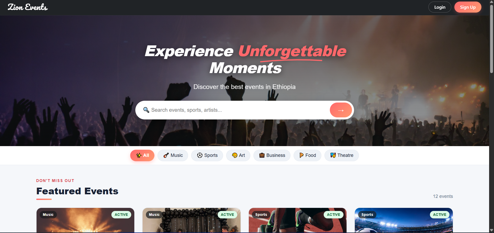
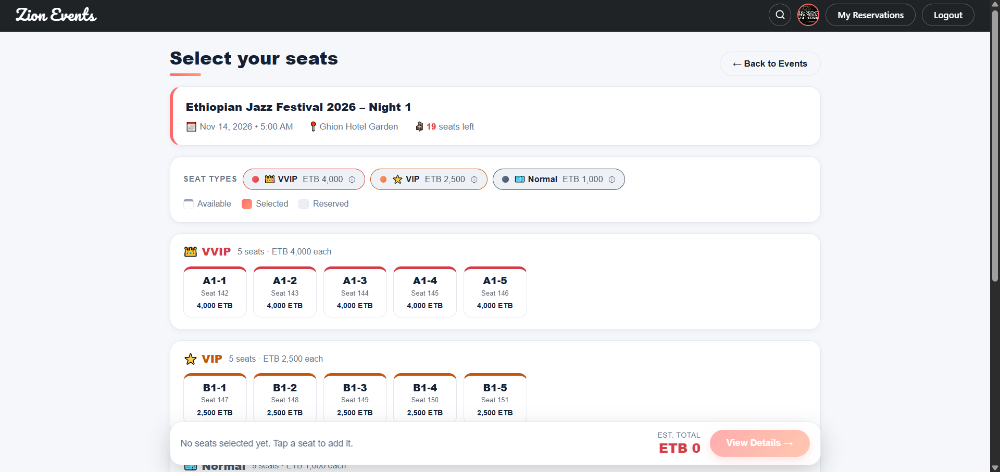
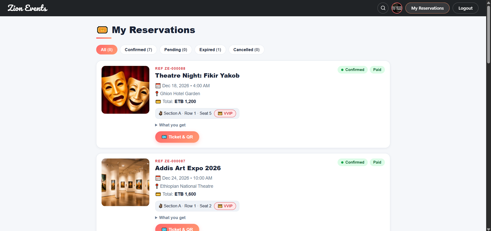
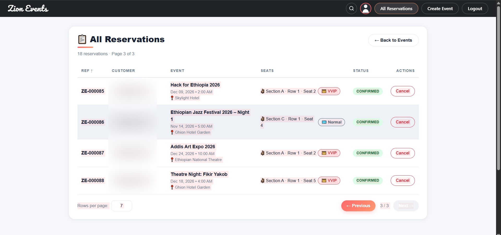
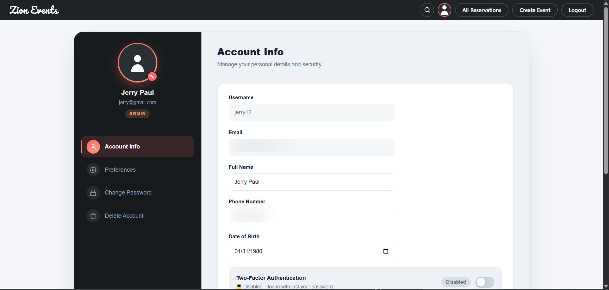

# Zion Events

**Discover events across Ethiopia. Pick your exact seat. Pay securely. Get your ticket by email.**

A full-stack ticketing platform where attendees browse concerts, sports, theatre and more, choose seats by tier (Normal, VIP, VVIP), pay online with Chapa, and receive a ticket for every seat. Admins manage events and reservations from a dedicated dashboard.



## Features

**For attendees**
- Browse events by category with search, live seat counts and tier-based prices
- Interactive seat map showing available, selected and reserved seats, with a sticky summary bar
- Secure online payment through Chapa, with a 5-minute seat hold
- One ticket email per seat after payment
- My Reservations page with status badges, reference numbers, a hold countdown and a printable QR ticket
- Profile management: photo upload, password change, account deletion with confirmation
- Light and dark themes, in English, Amharic, Afaan Oromo and Tigrigna

**For admins**
- Create, edit and cancel events, with image upload and live tier price preview
- Paginated, sortable reservations table with cancel and automatic seat release
- Optional two-factor authentication by email code

**Security**
- JWT authentication with role-based access (USER and ADMIN)
- Email verification on sign-up and password reset by emailed code
- Secrets read from environment variables, and sortable columns whitelisted against SQL injection

## Tech stack

| Layer | Technology |
|---|---|
| Frontend | React, Vite, React Router, Axios, Bootstrap, qrcode.react |
| Backend | Java 17+, Spring Boot 3, Spring Security, JdbcTemplate |
| Database | MySQL 8 |
| Integrations | Chapa (payments), Cloudinary (images), Gmail SMTP (email) |

## Screenshots

| Seat selection | My reservations |
|---|---|
|  |  |

| Admin reservations | Profile |
|---|---|
|  |  |

## Getting started

### Prerequisites
- JDK 17 or newer
- Node.js 18 or newer
- MySQL 8

### 1. Database
```sql
CREATE DATABASE ticketing_system_clean;
```

### 2. Backend
Set these environment variables with your own values:

| Variable | Description |
|---|---|
| `DB_PASSWORD` | MySQL password |
| `JWT_SECRET` | Random string, at least 32 characters |
| `MAIL_USERNAME` / `MAIL_PASSWORD` | Gmail address and app password |
| `CLOUDINARY_CLOUD_NAME` / `CLOUDINARY_API_KEY` / `CLOUDINARY_API_SECRET` | Cloudinary credentials |
| `CHAPA_SECRET_KEY` | Chapa test secret key |
| `CHAPA_WEBHOOK_HASH` | Chapa webhook secret |

Generate a JWT secret:
```bash
node -e "console.log(require('crypto').randomBytes(48).toString('base64'))"
```

Run the API:
```bash
cd TicketingSystemBackend
./mvnw spring-boot:run
```
The API runs on `http://localhost:8083`.

### 3. Frontend
```bash
cd TicketingSystemFrontend
npm install
npm run dev
```
The app runs on `http://localhost:5173`.

## Pricing model

Zion Events uses a flexible, tier-based pricing system:
**Explicit Tier Pricing:** Admins can set specific prices for each seat category (**Normal, VIP, VVIP**) directly from the Create/Edit Event dashboard.
**Dynamic Fallback:** If an admin leaves the VIP or VVIP prices blank, the system intelligently calculates them based on the base event price and standard multipliers (**VIP ×1.5**, **VVIP ×2**). 

## Project structure

```
Ticketing System/
├── TicketingSystemBackend/    Spring Boot API
├── TicketingSystemFrontend/   React app
└── docs/screenshots/          README images
```

## Roadmap
- QR check-in endpoint for ticket scanning
- Dedicated `EXPIRED` reservation status
- Automated tests for the reservation flow

## License
MIT